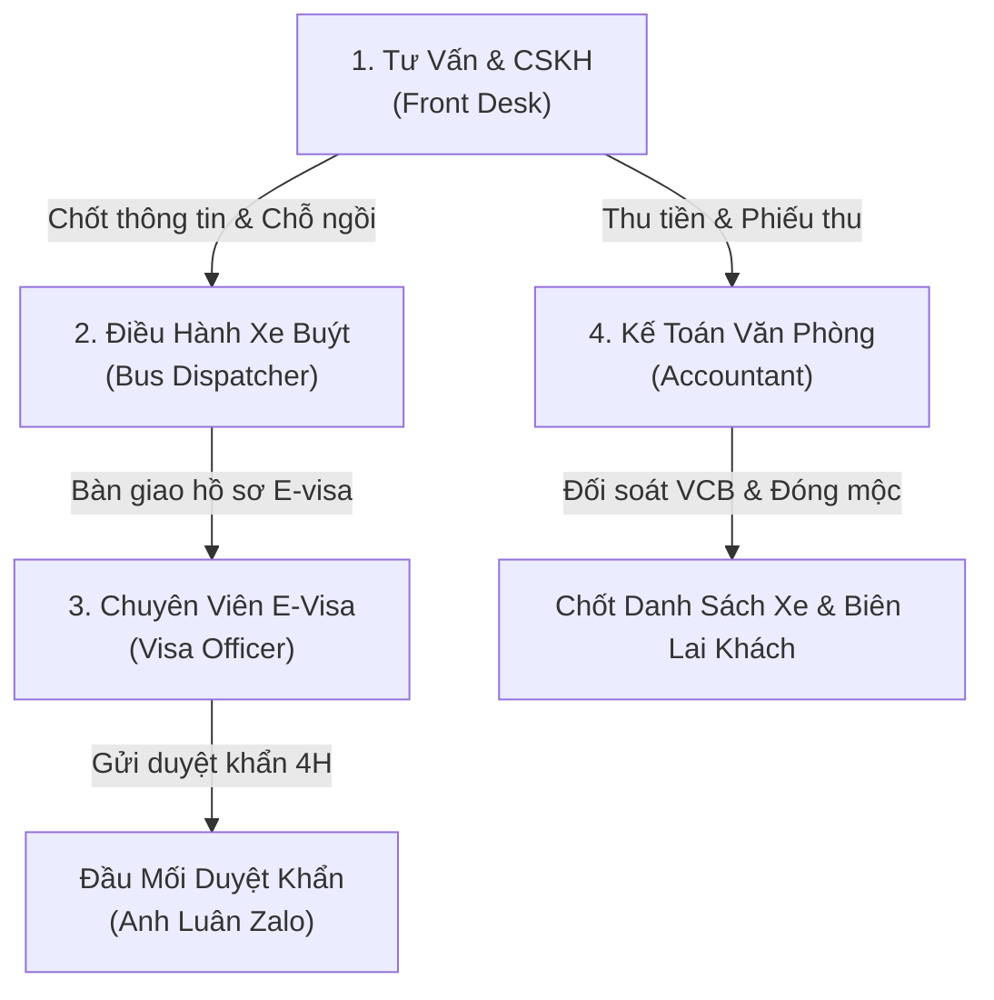

# CÔNG TY TNHH EASY TRIP & VISA
**MÃ SỐ DOANH NGHIỆP: 4202051389 | TRỤ SỞ: 21 PHAN VINH, NHA TRANG**

---

# QUY TRÌNH VẬN HÀNH CHUẨN (SOP)
### *DÀNH CHO BỘ PHẬN HÀNH CHÍNH - VĂN PHÒNG & ĐIỀU HÀNH DỊCH VỤ VISARUN*

| Thông tin quản trị | Chi tiết |
| :--- | :--- |
| **Mã tài liệu:** | `SOP-OPS-01 (EasyTrip Operations)` |
| **Phiên bản áp dụng:** | `Phiên bản 4.2` (Chuẩn hóa thủ tục cửa khẩu & quy định in ấn E-visa) |
| **Bộ phận ban hành:** | Khối Hành chính - Văn phòng, CSKH & Điều hành Vận tải |
| **Người phê duyệt:** | **Ông Lý Việt Hoàng** - Chủ tịch / Giám đốc điều hành (+84 89 69 16 361) |

---

## PHẦN 1: TỔNG QUAN DOANH NGHIỆP & KÊNH LIÊN HỆ CHÍNH THỨC

### 1. Thông tin pháp nhân:
* **Tên công ty:** Công ty TNHH Easy Trip & Visa (EASY TRIP & VISA CO. LTD).
* **Mã số thuế / Mã số doanh nghiệp:** `4202051389`.
* **Trụ sở văn phòng:** 21 Phan Vinh, Phường Vĩnh Nguyên (Nam Nha Trang), Tỉnh Khánh Hòa.
* **Website chính thức:** [https://www.easytripvisa.com](https://www.easytripvisa.com)

### 2. Tài khoản ngân hàng thu tiền chính thức:
* **Ngân hàng:** Ngân hàng TMCP Ngoại Thương Việt Nam (**Vietcombank - VCB**).
* **Tên tài khoản:** `CÔNG TY TNHH EASY TRIP & VISA` (EASY TRIP & VISA CO. LTD).
* **Số tài khoản:** `1068582577` (Chỉ nhận chuyển khoản VNĐ).
* **Mã QR:** Vietcombank OneQR Code tích hợp tự động trên hóa đơn và Chatbot.

### 3. Kênh liên hệ và điều phối chính thức:
* **Hotline / Zalo chính thức:** `+84 853 201 277` ([https://zalo.me/84853201277](https://zalo.me/84853201277))
* **WhatsApp CSKH chính thức:** `+84 853 201 277` ([https://wa.me/84853201277](https://wa.me/84853201277))
* **Hotline Ban Giám Đốc (Mr. Lý Việt Hoàng):** `+84 89 69 16 361` (Hỗ trợ tiếng Anh / Việt)
* **Telegram hỗ trợ & điều phối:** `@easytripvisa` | [https://t.me/easytripvisa_co_ltd](https://t.me/easytripvisa_co_ltd)

---

## PHẦN 2: PHÂN CÔNG TRÁCH NHIỆM BỘ PHẬN HÀNH CHÍNH & ĐIỀU HÀNH (RACI)



| Vị Trí / Nhân Sự | Nhiệm Vụ Trọng Tâm Trong Ca Trực |
| :--- | :--- |
| **1. Tư Vấn & CSKH (Front Desk)** | Tiếp nhận tin nhắn/cuộc gọi; tư vấn tuyến đường và ngày xe chạy; hướng dẫn khách chọn ghế; gửi thông tin thanh toán; đóng dấu mộc đỏ biên lai gửi khách và thực hiện chăm sóc sau chuyến đi, xin đánh giá Google Maps. |
| **2. Điều Hành Xe Buýt (Bus Dispatcher)** | Gửi lệnh Scheme lấy sơ đồ ghế từ đối tác nhà xe (Chị Ngọc Cao / Liên Hưng); thực hiện lệnh Lock ghế vào đúng Topic Telegram; chốt danh sách đón khách trước 14:00 hàng ngày và kết nối trực tiếp với tài xế tại điểm đón. |
| **3. Chuyên Viên E-Visa (Visa Officer)** | Đăng ký hồ sơ E-visa trên Cổng dịch vụ công Bộ Công An; nộp phí Nhà nước; gửi mã hồ sơ vào Zalo cho Anh Luân đẩy duyệt khẩn 4 tiếng; thu nhận ảnh dấu xuất cảnh của khách trước 08:00 sáng và gửi trả file PDF visa trước 11:30 sáng. |
| **4. Kế Toán Văn Phòng (Accountant)** | Đối soát tiền chuyển khoản Vietcombank; phê duyệt thanh toán; in biên lai đóng dấu mộc đỏ pháp nhân; hạch toán hoa hồng cho các đại lý đối tác (Sergei, Bolot, Arcenii) và đồng bộ dữ liệu doanh thu lên CRM. |

---

## PHẦN 3: HÀNH TRÌNH 7 BƯỚC TƯƠNG TÁC, TƯ VẤN & XỬ LÝ ĐƠN HÀNG

### Bước 1: Kiểm Tra Ngày Tháng & Phân Luồng Tuyến Đường Phù Hợp
Khi khách hàng liên hệ, nhân viên văn phòng gửi ngay 3 câu hỏi định danh tiêu chuẩn:
> *"Xin chào! Vui lòng cho EasyTrip biết: 1. Ngày hết hạn Visa của bạn? 2. Quốc tịch của bạn? 3. Thành phố hiện tại bạn đang ở (Nha Trang / Đà Nẵng)?"*

#### A. Quy tắc phân loại quốc tịch và chọn tuyến cửa khẩu:
* **Quốc tịch được miễn visa Lào (Nga, Belarus, Hàn Quốc, Malaysia, các nước ASEAN...):** Tư vấn đi **Tuyến Lào (Cửa khẩu Bờ Y)** để tiết kiệm chi phí visa Lào. Được chọn gói Miễn visa 45 ngày (`1.400.000 VNĐ`) hoặc E-visa 90 ngày (`3.400.000 VNĐ`).
* **Quốc tịch KHÔNG được miễn visa Lào (Mỹ, Canada, Úc, Anh, Ukraine, Ai Cập, Ma-rốc, Thổ Nhĩ Kỳ...):** BẮT BUỘC ĐI **TUYẾN CAMPUCHIA (Cửa khẩu Mộc Bài)**. Khách nhóm này KHÔNG được chọn gói Miễn visa 45 ngày mà bắt buộc phải chọn gói E-visa 90 ngày (`4.000.000 VNĐ`).

#### B. Thuật toán khớp lịch xe an toàn chống quá hạn visa (Anti-Overstay):
* **Nguyên tắc cốt lõi:** Xe khởi hành ban đêm, sáng hôm sau (06:00) đến cửa khẩu. Do đó, **ngày xuất bến xe muộn nhất phải trước ngày hết hạn visa 1 ngày**.
* **Tuyến 45D Lào:** Khởi hành **MỖI TỐI** lúc 21:30 (Đón tại 40 Hòn Chồng) hoặc 21:15 (Số 4 Trần Phú).
* **Tuyến 90D Lào & Tuyến Campuchia Mộc Bài:** Khởi hành vào các tối **Thứ 3, Thứ 5, Chủ Nhật** lúc 21:30.
* **Xử lý lùi ngày:** Nếu ngày an toàn không trùng ngày có xe chạy (Thứ 2, 4, 6, 7), nhân viên chủ động tư vấn lùi về chuyến xe chạy gần nhất trước đó.

---

### Bước 2: Cung Cấp Sơ Đồ Ghế & Thực Hiện Khóa Chỗ (Seat Map & Locking)
1. **Kiểm tra tình trạng ghế trống:** Truy cập Telegram ➔ Nhóm `"Easytrip Booking Bus"` ➔ Topic `"# General"`.
   * Cú pháp: `Scheme [ngày] + [loại dịch vụ]`
   * *Ví dụ: Scheme 13/09 45D Laos | Scheme 15/09 90D Laos | Scheme 15/09 Mộc Bài*
2. **Nhận sơ đồ xe** từ Chị Ngọc Cao hoặc đại diện nhà xe Liên Hưng.
3. **Gửi sơ đồ cho khách và hướng dẫn cấu trúc xe buýt:**
   * 🟢 **TẦNG DƯỚI (Dãy số LẺ):** Gồm các cabin `A1`, `B1`, `A3`, `B3`, `A5`, `B5`, `A7`, `B7`, `A9`, `B9`, `A11` *(Phía cuối tầng dưới có Nhà vệ sinh WC cạnh A11)*.
   * 🔵 **TẦNG TRÊN (Dãy số CHẴN):** Gồm các cabin `A2`, `B2`, `A4`, `B4`, `A6`, `B6`, `A8`, `B8`, `A10`, `B10`, `A12` *(Ghế A12 chiều dài 160 cm, tất cả các ghế còn lại dài 180 cm)*.
   * **Phân bổ dãy:** Dãy **A** nằm bên trái (phía sau ghế tài xế), Dãy **B** nằm bên phải (phía cửa lên xuống).
4. **Khóa ghế trên Telegram:** Ngay khi khách chọn số ghế, gửi lệnh vào đúng Topic chuyến xe tương ứng:
   ```text
   [Ngày khởi hành] - [Loại dịch vụ] [Điểm đến]
   [Tên khách hàng] + [Năm sinh]
   Số ghế: [Số ghế]
   Điểm đón: [40 Hòn Chồng / Số 4 Trần Phú]
   Nguồn: [Kênh nguồn tiếp nhận]
   Trạng thái: Chưa thanh toán (Bắt buộc thanh toán trước 14:00 ngày khởi hành)
   ```

---

### Bước 3: Hướng Dẫn Thanh Toán & Thu Thập Hồ Sơ E-Visa
1. Gửi thông tin tài khoản Vietcombank chính thức (`1068582577`) và ảnh mã Vietcombank OneQR cho khách.
2. **Báo giá chuẩn:** Khách Free visa chỉ trả `1.400.000 VNĐ`; Khách E-visa trả trọn gói tiền vé xe + phí visa.
3. **Quy chuẩn hồ sơ E-visa cần thu thập:**
   * **Ảnh hộ chiếu gốc:** Chụp rõ 4 góc, đầy đủ 2 dòng mã ICAO phía dưới, không lóa đèn flash, không có ngón tay che chữ.
   * **Ảnh chân dung:** Nền sáng/trắng, chụp thẳng khuôn mặt, không đeo kính râm hoặc mũ nón.

---

### Bước 4: Đóng Dấu Mộc Đỏ Biên Lai & Xác Nhận Chốt Chỗ
1. Khi kế toán xác nhận tiền đã vào tài khoản, nhân viên chụp ảnh/in biên lai thanh toán.
2. In biên nhận, **ĐÓNG DẤU MỘC ĐỎ CHÍNH THỨC** của Công ty TNHH Easy Trip & Visa, chụp ảnh gửi lại cho khách làm bằng chứng thanh toán.
3. Cập nhật trạng thái trên nhóm Telegram thành `"Đã tt"`.

---

### Bước 5: Nộp Hồ Sơ E-Visa & Đẩy Duyệt Khẩn 4 Giờ Qua Zalo
1. Chuyên viên visa nhập liệu trên Cổng dịch vụ công Bộ Công An và thanh toán lệ phí Nhà nước.
2. Sao chép mã hồ sơ E-visa gửi vào nhóm Zalo nghiệp vụ để Anh Luân đẩy duyệt khẩn 4 tiếng.
3. **Khung thời gian nghiệp vụ chuẩn:**
   * **21:30 Tối Ngày X:** Khách lên xe buýt khởi hành từ Nha Trang.
   * **06:00 - 07:00 Sáng Ngày X+1:** Khách đến khu vực cửa khẩu biên giới.
   * **07:30 - 08:00 Sáng Ngày X+1:** Khách xuất cảnh VN, **CHỤP ẢNH DẤU XUẤT CẢNH GỬI CHO EASYTRIP TRƯỚC 08:00 SÁNG**.
   * **08:00 - 11:30 Sáng Ngày X+1:** E-visa được cấp và gửi trực tiếp vào tin nhắn riêng cho khách.

---

### Bước 6: Gửi Trả E-Visa & Hướng Dẫn Nhập Cảnh Lại (QUY ĐỊNH IN ẤN ĐẶC BIỆT)
1. Tải file PDF E-visa chính thức và gửi qua tin nhắn riêng cho khách.
2. **QUY ĐỊNH BẮT BUỘC VỀ IN ẤN E-VISA (PHÂN BIỆT RÕ THEO TUYẾN):**
   * 🔴 **TẠI MỘC BÀI (CAMPUCHIA):** Khách **BẮT BUỘC PHẢI IN E-VISA RA GIẤY A4** tại tiệm dịch vụ/quán cà phê cửa khẩu để trình hải quan. Cửa khẩu Mộc Bài không chấp nhận bản hiển thị trên điện thoại.
   * 🟢 **TẠI BỜ Y (LÀO):** **KHÔNG CẦN IN RA GIẤY**. Hải quan cửa khẩu Bờ Y chấp nhận bản điện tử PDF trên màn hình điện thoại di động.
3. **Nhắc nhở giờ xe buýt quay về:** Xe đón khách quay về Nha Trang đúng **13:00 (1:00 PM)**. Nếu hàng chờ nhập cảnh quá đông, nhân viên nhắn tin trấn an khách: *"Yên tâm đi, chúng tôi đã dặn tài xế, xe buýt sẽ vẫn đợi các bạn."*

---

### Bước 7: Rà Soát Cuối Cùng & Gửi Mẫu Tin Nhắn Xin Đánh Giá Review 5 Sao
Khi khách đã lên xe buýt chiều về an toàn, nhân viên gửi mẫu tin nhắn tri ân và link đánh giá Google Maps:
> *"Quý Khách hàng thân mến! Công ty TNHH Easy Trip & Visa (Mã số DN: 4202051389) xin chân thành cảm ơn Quý khách đã tin tưởng và sử dụng dịch vụ của chúng tôi. Chúng tôi rất mong nhận được phản hồi và đánh giá của Quý khách trên Google Maps tại: https://g.page/r/CREMymPQwmBuEBI/review"*

---

## PHẦN 4: BIỂU PHÍ DỊCH VỤ, ƯU ĐÃI KHÁCH CŨ & PHỤ PHÍ QUỐC TỊCH

| Gói Dịch Vụ Visarun | Khách Mới | Khách Cũ CRM | Đại Lý (Sergei/Bolot/Arcenii) |
| :--- | :--- | :--- | :--- |
| **Free Visa 45D Lào (Bờ Y)** | `1.400.000 VNĐ` | `1.300.000 VNĐ` | `1.000.000đ - 1.100.000đ` |
| **Free Visa 45D Cam (Mộc Bài)** | `1.400.000 VNĐ` | `1.300.000 VNĐ` | `1.100.000đ - 1.200.000đ` |
| **E-visa 90D Single Lào (Nga)** | `3.400.000 VNĐ` | `3.000.000 VNĐ` | `2.520.000đ - 2.800.000đ` |
| **E-visa 90D Multi Lào (Nga)** | `4.400.000 VNĐ` | `4.000.000 VNĐ` | `3.520.000đ - 3.800.000đ` |
| **E-visa 90D Cam (Mỹ, Úc, Anh...)** | `4.000.000 VNĐ` | `3.550.000 VNĐ` | `2.520.000đ - 2.800.000đ` |

### Chính sách phụ phí & đối tượng đặc biệt:
* **Phụ phí quốc tịch hạn chế Nhóm 1 (Ai Cập, Algeria, Tunisia, Sri Lanka, Mauritius, Morocco):** `+ 850.000 VNĐ`.
* **Phụ phí quốc tịch khó Nhóm 2 (Thổ Nhĩ Kỳ / Turkey):** `+ 650.000 VNĐ`.
* **Phụ phí chuyển đổi E-visa Multi:** `+ 1.000.000 VNĐ` so với gói Single tương ứng.
* **Làm thêm Visa Campuchia trọn gói:** `+ 1.000.000 VNĐ` (nếu khách nhờ công ty thanh toán trước).
* **Trẻ em dưới 9 tuổi:** **MIỄN PHÍ VÉ XE BUÝT (0 VNĐ)** khi nằm chung giường với phụ huynh; chỉ thu phí làm E-visa nếu có.

---

## PHẦN 5: CẨM NANG HƯỚNG DẪN THỦ TỤC CHI TIẾT TẠI CỬA KHẨU

### Hướng Dẫn A: Tuyến Free Visa 45 Ngày Lào (Cửa Khẩu Bờ Y)
* **Khởi hành:** 21:30 hàng đêm tại 40 Hòn Chồng (Nha Trang).
* **Lịch trình tại cửa khẩu:**
  - **07:30:** Đến trạm kiểm soát Lào ➔ Tự vào đóng dấu nhập cảnh và xuất cảnh Lào ➔ Quay trở lại trạm Việt Nam.
  - **08:00:** Xếp hàng đóng dấu nhập cảnh miễn visa 45 ngày vào Việt Nam.
  - **08:10 - 09:15:** Uống cà phê, ăn sáng nghỉ ngơi tại quán ăn cửa khẩu.
  - **09:30:** Lên xe buýt khởi hành về Nha Trang.
* **Chi phí tiền mặt kẹp hộ chiếu:** Xuất cảnh VN 50k + Nhập cảnh Lào 20k + Xuất cảnh Lào 20k + Nhập cảnh VN 50k = Tổng cộng `140.000 VNĐ/người`.

### Hướng Dẫn B: Tuyến E-Visa 90 Ngày Campuchia (Cửa Khẩu Mộc Bài)
* **Khởi hành:** Tối Thứ 3, Thứ 5, Chủ Nhật lúc 21:30 từ 40 Hòn Chồng.
* **Lịch trình tại cửa khẩu:**
  - **06:30:** Đến Cửa khẩu Mộc Bài (Cửa khẩu mở cửa lúc 07:30).
  - **07:30:** Xuất cảnh Việt Nam (đóng phí 50.000đ - 150.000đ).
  - **08:00:** **CHỤP ẢNH CON DẤU XUẤT CẢNH VN VÀ GỬI CHO EASYTRIP TRƯỚC 08:00 SÁNG**.
  - **08:15:** Sang trạm kiểm soát Campuchia, mua Visa Campuchia tại chỗ ($35 - $50).
  - **08:30 - 11:30:** Nghỉ ngơi tại quán cà phê địa phương trong lúc EasyTrip làm E-visa gấp 4 giờ.
  - **11:30:** Nhận file PDF E-visa ➔ **BẮT BUỘC PHẢI IN RA GIẤY A4** tại tiệm dịch vụ ở cửa khẩu.
  - **11:45:** Xếp hàng nhập cảnh trở lại Việt Nam.
  - **13:00:** Lên xe buýt và trở về Nha Trang.

### Hướng Dẫn C: Tuyến E-Visa 90 Ngày Lào (Cửa Khẩu Bờ Y)
* **Khởi hành:** Tối Thứ 3, Thứ 5, Chủ Nhật lúc 21:30 từ 40 Hòn Chồng.
* **Các bước thực hiện:** Xuất cảnh VN (phí 50k) ➔ Chụp ảnh dấu xuất cảnh gửi EasyTrip ➔ Sang Lào nộp tờ khai và phí 20k ➔ Nghỉ tại quán cà phê khu trung lập ➔ 11:30 nhận E-visa qua điện thoại (**KHÔNG CẦN IN RA GIẤY**) ➔ Nhập cảnh VN (phí 50k) và **NHẮC CÁN BỘ ĐÓNG DẤU ĐÚNG 90 NGÀY** ➔ 13:00 lên xe buýt về Nha Trang.

---

## PHẦN 6: QUY TRÌNH XỬ LÝ SỰ CỐ & TÌNH HUỐNG KHẨN CẤP

### 1. Cán bộ hải quan đóng nhầm dấu 45 ngày thay vì 90 ngày:
Ngay trước khi bước ra khỏi tòa nhà cửa khẩu, khách phải kiểm tra con dấu. Nếu bị đóng nhầm 45 ngày, hướng dẫn khách quay lại ngay quầy xuất trình tờ E-visa để cán bộ gạch dấu cũ và đóng lại dấu 90 ngày.

### 2. Khách gửi ảnh dấu xuất cảnh trễ sau 08:00 sáng:
Nhân viên gọi điện hỗ trợ khách bắt Wifi quán café gửi ảnh gấp, đồng thời liên hệ ngay Anh Luân để đưa vào diện xử lý đặc biệt.

### 3. Hàng chờ nhập cảnh ùn tắc gần đến giờ xuất bến 13:00:
Nhân viên gọi điện cho tài xế giữ xe chờ khách, đồng thời gửi tin nhắn cho khách yên tâm hoàn tất thủ tục mà không lo bị bỏ rơi.

---

## PHẦN 7: CHECKLIST KIỂM SOÁT CÔNG VIỆC HÀNG NGÀY THEO CA TRỰC

* **CA SÁNG (07:30 - 12:00):** Gom ảnh dấu xuất cảnh trước 08:00 ➔ Theo dõi duyệt E-visa khẩn 4 tiếng ➔ Quét nhắc nhở hạn visa trước 10 ngày (`visa_reminder.py`) ➔ Trả file PDF E-visa lúc 11:30 ➔ Nhắc khách Mộc Bài in giấy A4.
* **CA CHIỀU (12:00 - 17:30):** Xác nhận khách lên xe chiều về an toàn lúc 13:00 ➔ Khóa sổ thu tiền khách tối nay lúc 14:00 ➔ Đối soát VCB và đóng dấu mộc đỏ biên lai ➔ Bắn danh sách chốt vào Topic Telegram.
* **CA TỐI (17:30 - 22:00):** Nhắn tin nhắc khách có mặt lúc 20:45 ➔ Điều phối đón khách tại Số 4 Trần Phú (21:15) và 40 Hòn Chồng (21:30) ➔ Bàn giao tài xế và lưu trữ hồ sơ CRM.

---

| KHỐI HÀNH CHÍNH & VẬN HÀNH | CÔNG TY TNHH EASY TRIP & VISA |
| :---: | :---: |
| *(Người lập quy trình)* | **CHỦ TỊCH / GIÁM ĐỐC ĐIỀU HÀNH**<br><br><br><br>**LÝ VIỆT HOÀNG** |
